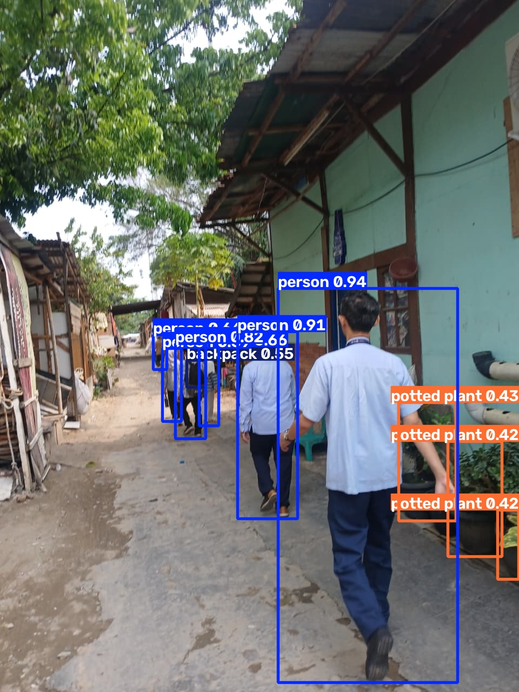

# Laporan Tugas Praktikum Pertemuan 10: Deteksi Objek dengan YOLO

Nama: ...
NIM: ...
Mata kuliah: Pembelajaran Mendalam untuk Pengolahan Citra

## Tujuan

Tugas ini menjalankan deteksi objek dengan model YOLO pretrained pada gambar dan video milik sendiri, lalu mengukur precision, recall, dan mAP model tersebut pada dataset berlabel.

## Isi folder

| File | Keterangan |
|---|---|
| `deteksi_yolo.py` | Program deteksi untuk gambar, video, dan kamera |
| `yolo11m.pt` | Model yang dipakai program (YOLO11 ukuran medium) |
| `yolov8n.pt` | Model awal dari modul praktikum, dipakai sebagai pembanding |
| `hasil/hasil_gambar1.jpeg` | Hasil deteksi pada foto sendiri |
| `hasil/kamera.mp4` | Rekaman deteksi langsung dari kamera laptop |

## Cara menjalankan

Jalankan dari folder `Pertemuan10` dengan Python dari virtual environment `.venv`:

```bash
.venv/bin/python tugas/deteksi_yolo.py gambar1.jpeg      # deteksi pada gambar
.venv/bin/python tugas/deteksi_yolo.py video_sampel.mp4  # deteksi pada video
.venv/bin/python tugas/deteksi_yolo.py                   # deteksi live dari kamera, tekan q untuk berhenti
```

Program mencetak jumlah objek per kelas, misalnya `6 person, 1 backpack, 3 potted plant`, lalu menyimpan gambar atau video berkotak deteksi ke folder `hasil/`. Pada video dan kamera, ringkasan jumlah objek juga ditulis di pojok kiri atas setiap frame.

## Cara kerja program

1. Model dimuat sekali di awal dengan `YOLO("yolo11m.pt")`.
2. Setiap gambar atau frame video dimasukkan ke model dengan ambang keyakinan `conf=0.4`. Deteksi dengan skor di bawah 0,4 dibuang. Nilai bawaan YOLO adalah 0,25, dan pada percobaan nilai itu masih meloloskan cukup banyak deteksi yang salah.
3. `hasil.plot()` menggambar kotak, nama kelas, dan skor keyakinan.
4. Fungsi `ringkas()` menghitung jumlah objek per kelas dengan `Counter`.
5. Hasil disimpan dengan OpenCV (`cv2.imwrite` untuk gambar, `cv2.VideoWriter` untuk video).

## Pemilihan model

Modul praktikum memakai `yolov8n.pt`, model terkecil yang cepat tetapi paling sering salah atau terlewat. Program ini memakai `yolo11m.pt`, yang menurut dokumentasi Ultralytics mencapai mAP50-95 51,5 pada COCO val2017, sedangkan YOLOv8n 37,3. Kekurangannya, YOLO11m lebih lambat. Untuk kamera di laptop yang lebih lemah, model bisa diganti ke `yolo11s.pt` di baris pemuatan model.

## Hasil pada gambar sendiri



| Model | Objek yang terdeteksi |
|---|---|
| YOLOv8n | 6 person, 2 potted plant |
| YOLO11m (conf 0,4) | 6 person, 1 backpack, 3 potted plant |

Kedua model menemukan enam orang di gang tersebut. YOLO11m juga mengenali tas ransel salah satu orang di belakang dan satu tanaman pot tambahan di sisi kanan. Orang paling depan dideteksi dengan skor 0,94 dan orang kedua 0,91. Orang yang jauh dan saling tumpang tindih mendapat skor lebih rendah (0,6 sampai 0,8), karena ukurannya kecil dan sebagian badannya tertutup orang lain. Tanaman pot hanya mendapat skor sekitar 0,42, sedikit di atas ambang. Pot di foto ini tergantung di dinding dan bentuknya berbeda dari pot di lantai yang lebih umum di data latih COCO.

Gambar ini tidak memiliki label, jadi penilaiannya kualitatif. Angka precision, recall, dan mAP diukur pada dataset berlabel di bagian berikut.

## Evaluasi kuantitatif pada COCO128

Kedua model diuji pada COCO128 (128 gambar dengan label, 80 kelas) menggunakan `model.val(data="coco128.yaml")` di GPU Apple (MPS).

| Model | Precision | Recall | mAP50 | mAP50-95 | Waktu inferensi per gambar |
|---|---|---|---|---|---|
| YOLOv8n | 0,640 | 0,537 | 0,605 | 0,444 | 12,2 ms |
| YOLO11m | 0,803 | 0,695 | 0,797 | 0,621 | 22,3 ms |

YOLO11m lebih baik di semua metrik. Precision naik dari 0,64 ke 0,80, artinya kotak yang salah tebak berkurang. Recall naik dari 0,54 ke 0,70, artinya objek yang terlewat juga berkurang. Harganya, waktu inferensi hampir dua kali lipat, tetapi 22 ms per gambar masih sekitar 45 frame per detik dan cukup untuk kamera secara langsung.

Catatan: gambar COCO128 diambil dari COCO train2017, data yang dipakai untuk melatih kedua model. Karena model pernah melihat gambar ini, angka di atas lebih tinggi dari performa pada gambar baru. Angka ini cocok untuk membandingkan kedua model, tetapi bukan ukuran akurasi sebenarnya. Untuk ukuran yang jujur, model perlu diuji pada data yang tidak dipakai saat pelatihan, misalnya COCO val2017 atau foto sendiri yang diberi label.

## Perbedaan YOLOv5 dan YOLOv8

YOLOv5 dan YOLOv8 sama-sama dibuat oleh Ultralytics. Perbedaan utamanya:

- Arsitektur. YOLOv5 memakai anchor box, yaitu ukuran kotak acuan yang ditentukan sebelum pelatihan. YOLOv8 bersifat anchor-free dan langsung memprediksi pusat dan ukuran objek. YOLOv8 juga mengganti blok C3 di backbone dengan blok C2f, dan memisahkan cabang klasifikasi dan regresi kotak di bagian head (decoupled head).
- Performa. Pada ukuran yang sama YOLOv8 lebih akurat. Di COCO, mAP50-95 YOLOv5n 28,0 dan YOLOv8n 37,3, sedangkan YOLOv5s 37,4 dan YOLOv8s 44,9.
- Kemudahan penggunaan. YOLOv5 awalnya dipakai dengan meng-clone repositori dan menjalankan skrip seperti `detect.py` dan `train.py`. YOLOv8 dipasang dengan `pip install ultralytics` dan dipakai lewat API Python (`YOLO("yolov8n.pt")`) atau perintah `yolo`. Paket yang sama juga menangani segmentasi, klasifikasi, dan estimasi pose.

## Kesimpulan

Model YOLO pretrained bisa langsung mendeteksi orang dan benda sehari-hari pada foto sendiri tanpa pelatihan ulang. Mengganti YOLOv8n dengan YOLO11m dan menaikkan ambang keyakinan ke 0,4 menambah objek yang ditemukan dan mengurangi tebakan salah. Di COCO128, mAP50-95 naik dari 0,444 ke 0,621, dengan waktu inferensi yang masih cukup untuk video langsung. Model ini tetap hanya mengenal 80 kelas COCO. Untuk objek di luar daftar itu, model harus dilatih ulang dengan dataset sendiri.
